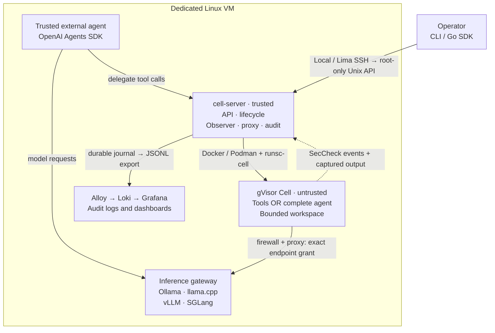
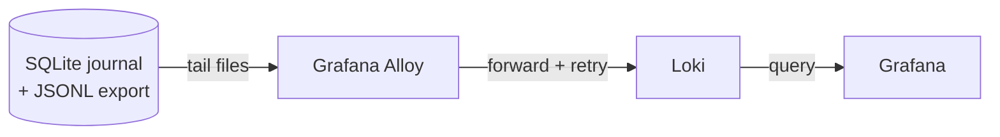

# Relayna Cell

Relayna Cell runs agent workloads and delegated tools in gVisor sandboxes. It audits process execution and enforces network, filesystem, and resource restrictions. The Go implementation supports both an external agent submitting commands and a complete agent running inside a Cell.

This is a development MVP for one trusted operator on a dedicated Linux VM, including Lima on an Apple Silicon Mac. Docker or Podman hosts `runsc`, the Cell service, and the Grafana logging stack. Model inference remains outside the sandbox.

## Architecture at a glance

Cell separates the **workload sandbox**, the **trusted control plane**, and **shared inference and observability**. Every workload uses gVisor; a local model runs outside the sandbox and returns tool calls for the agent to execute inside it.



The API/lifecycle controller, SecCheck receiver, egress proxy, and audit store are modules in one Go `cell-server` process. The container engine, VM host, and these modules are trusted. Inference and observability run in separate containers outside gVisor. Grafana is available on Linux loopback at `localhost:3000`, or through the existing Lima setup on the Mac at `localhost:3300`. The management API uses a root-only Unix socket.

### Components

| Component | Role | Implementation |
| --- | --- | --- |
| CLI and Go SDK | Create Cells, execute commands, transfer workspace files, and read retained events through the Unix API or Lima SSH. | [`cmd/cell`](cmd/cell), [`pkg/client`](pkg/client) |
| Cell API and lifecycle controller | Validate requests, manage deadlines and execution, revoke access, and clean up runtime resources. | [`internal/api`](internal/api), [`internal/engine`](internal/engine) |
| Docker / Podman adapters and gVisor | Require `runsc-cell`, isolate the workload, and apply filesystem, identity, CPU, memory, and process restrictions. | [`internal/runtime`](internal/runtime), [`deploy/runtime`](deploy/runtime) |
| Workload and `cell-init` | Run delegated commands or the complete agent; keep files in a bounded, per-Cell workspace. | [`cmd/cell-init`](cmd/cell-init), [`examples/agents-sdk`](examples/agents-sdk) |
| Egress proxy and host firewall | Block direct egress and authorize exact HTTP/CONNECT destinations. An offline Cell has no external network. | [`internal/network`](internal/network), [`scripts/network-guard.sh`](scripts/network-guard.sh) |
| Inference gateway and selected engine | Share the local model while exposing Chat Completions and restricting model-management routes. | [`deploy/inference`](deploy/inference), [`Linux setup`](docs/linux-setup.md) |
| SecCheck receiver | Receive gVisor process/connection observations outside the workload and attach trusted runtime provenance. | [`internal/observer`](internal/observer) |
| Audit journal and export | Commit events to SQLite, then export JSONL with stable event IDs; retain evidence after Cell deletion. | [`internal/audit`](internal/audit) |
| Grafana Alloy and Loki | Tail the exported records, forward them with retry, and store the searchable log projection. | [`deploy/observability`](deploy/observability) |
| Grafana | Show activity charts, outcomes, destinations, and per-Cell investigations with readable and raw logs. | [`deploy/observability/grafana`](deploy/observability/grafana) |

### Audit flow



Control-plane lifecycle events, proxy decisions, captured workload output, and gVisor SecCheck observations enter the journal. SQLite is authoritative; Loki is a downstream projection. Workload output retains its own source label and is not treated as trusted runtime evidence.

### Two execution modes

| | Agent delegates tools | Entire agent inside a Cell |
| --- | --- | --- |
| Agent loop | A trusted external agent calls the model and Cell API. | The agent and its tool subprocesses run inside gVisor. |
| Execution flow | Agent → Cell API → sandboxed command → result returned to agent. | Agent → approved inference endpoint → local tool subprocess → next agent turn. |
| Network boundary | Tool Cell can remain offline; the external agent handles inference. | Cell receives an explicit grant for the inference gateway. Other destinations remain denied. |
| Workspace | Shared between commands until the Cell ends. | Shared by the agent and its tools until the Cell ends. |

**Enforcement and auditing have different roles.** Filesystem, network, and resource restrictions enforce the sandbox boundary. Runtime audit events are asynchronous evidence, not synchronous approval of every operation. The current MVP does not guarantee detection of every escape attempt before it succeeds; silent removal of a trace session remains a known monitoring gap.

For deeper detail, see the [architecture decisions](docs/architecture.md). Download and open the [interactive architecture guide](docs/architecture.html) for component details, execution flows, and sequence diagrams; the HTML guide works offline.

## Start on Linux

From a checkout on a dedicated systemd Linux VM:

```bash
sudo bash scripts/setup-linux.sh
```

Choose **Docker or Podman**, then **Ollama, llama.cpp, vLLM, SGLang, or skip local inference**. The installer checks infrastructure first and asks you to install missing prerequisites yourself. Once checks pass, it installs Cell and gVisor, initializes SQLite storage, pulls the selected images/model, and provisions **Loki, Alloy, Grafana, and both dashboards**. It verifies an actual sandbox execution and audit delivery before reporting success.

Ollama/llama.cpp profiles use CPU; vLLM/SGLang profiles require a configured NVIDIA GPU. See the [Linux setup guide](docs/linux-setup.md) for prerequisites, unattended flags, model choices, access, and validation limits. Kubernetes support is planned separately.

## Start on macOS

Requirements: Apple Silicon, Go 1.26 or newer, Lima 2 or newer, and approximately 8 GiB available memory plus space for a 40 GiB sparse VM disk. The VM does not mount your Mac home directory or project files. Docker Desktop can remain installed and running; Cell uses its own VM and Docker daemon.

```bash
brew install lima
make vm-up
make install
./scripts/cell health
```

`make install` cross-compiles the Go binaries, copies the project deployment files into the VM, installs the pinned gVisor release, configures the network guard, and starts Cell plus Loki, Alloy, and Grafana. Reinstalling stops active Cells; their audit records remain. Initial provisioning downloads Ubuntu, Docker packages, and container images.

Open [Grafana on localhost](http://localhost:3300/d/relayna-cell/relayna-cell). It provides a local, anonymous **Viewer** account with a provisioned Loki datasource and dashboards. Only Grafana is forwarded to macOS, on loopback. Loki and the management API are not exposed on the Mac network.

The native Mac CLI uses SSH stdio through Lima to the root-only Unix socket inside the VM. There is no TCP management API or Docker socket exposed to workloads.

## Delegate commands from an external agent

```bash
./scripts/cell create -f examples/session.json
# Copy the returned id:
./scripts/cell exec CELL_ID -- sh -c 'printf hello > /workspace/result.txt'
./scripts/cell exec CELL_ID -- cat /workspace/result.txt
./scripts/cell put CELL_ID ./README.md input/README.md
./scripts/cell get CELL_ID result.txt > result.txt
./scripts/cell events --follow CELL_ID
./scripts/cell delete CELL_ID
```

The workspace survives tool calls within the same Cell. It is a bounded tmpfs and is destroyed with the runtime. Download artifacts **before** deleting the Cell or letting its lifetime expire. Uploads, downloads, stdin, and execution output are limited to 4 MiB per operation.

Run a complete external integration example with:

```bash
python3 examples/external-agent.py
```

The Go SDK lives in `pkg/client`. Use `client.NewLima("relayna-cell")` from macOS, or `client.New("/run/relayna-cell/api.sock")` from an authorized process inside the VM. The external agent's actions outside the Cell are outside Cell's isolation boundary.

## Run a complete agent inside a Cell

```bash
./scripts/cell create -f examples/agent.json
./scripts/cell events CELL_ID
./scripts/cell inspect CELL_ID
```

`agent` mode starts the supplied command as the workload. Its child processes remain inside gVisor. Runtime resources are removed when the workload finishes; events remain queryable. `session` mode starts a small idle init process and accepts repeated API executions.

`examples/contained-agent.py` is the minimal protocol example used by the deterministic integration fixture. For a real local model and agent framework, use the OpenAI Agents SDK setup below. The inference service never executes the generated tool itself.

## Local Ollama and OpenAI Agents SDK

Run these commands **from the project directory on your Mac**, after `make install`. If your prompt is `jobz@lima-relayna-cell:~$`, run `exit` first to return to macOS.

```bash
make inference-up   # start Ollama + inference gateway; download Qwen3 4B Instruct
make agents-build   # build the pinned Python OpenAI Agents SDK example image
make model-smoke    # exercise both modes with real model-generated code
```

The model is approximately 2.5 GB. Inference runs on the VM's CPU in a shared Ollama container outside gVisor, capped at 2 CPUs and 4 GiB memory. Model files persist in a Docker volume. The official Ollama image includes additional runtime libraries, so its image download is larger than the model. No OpenAI API key is needed: the SDK uses its Chat Completions adapter with an explicit local endpoint, and OpenAI tracing and Ollama cloud features are disabled.

The first agent framework is **OpenAI Agents SDK for Python**, pinned to `0.24.0`. Its `shell` function either submits an execution through Cell's API or starts a child process when the entire agent is already inside Cell. The real-model test asks the model to implement `add(a, b)` in `/workspace/add.py`, run a test, and finish. Separate assertions check the generated function with several inputs. A response without an actual tool call fails the test.

Only `/v1/chat/completions` is exposed by the inference gateway; model-management endpoints are blocked. No inference ports are published to macOS or the LAN. The test discovers the gateway's current private address and grants that exact endpoint to a contained agent. Delegated tool Cells remain offline. A small trusted external SDK runner has access to the local Cell API socket; the sandboxed workload never receives it.

The test cleans up its Cells and external SDK runner, retaining process/output audit history. A summary is stored inside the VM at `/var/lib/relayna-cell/model-smoke-latest.json`. In Grafana, filter by a Cell ID printed by the test. Contained SDK events appear as workload output; runtime process and network records retain their separate trusted provenance. Delegated SDK orchestration prints to the test console, while its executed commands and output are journaled by Cell.

Inspect the model from **macOS**:

```bash
limactl shell relayna-cell sudo docker compose -f /opt/relayna-cell/deploy/inference/compose.yaml ps
limactl shell relayna-cell sudo docker compose -f /opt/relayna-cell/deploy/inference/compose.yaml exec -T ollama ollama list
```

Inside the **Linux VM**, use the same `sudo docker compose ...` commands without the `limactl shell relayna-cell` prefix. To stop inference while keeping its downloaded model:

```bash
limactl shell relayna-cell sudo docker compose -f /opt/relayna-cell/deploy/inference/compose.yaml stop
```

See [the SDK agent](examples/agents-sdk/agent.py) and [inference deployment](deploy/inference/compose.yaml). This small model is intended for integration and simple coding experiments; passing this test does not establish general coding reliability.

## Security behavior

- gVisor is required. There is no fallback to `runc` for Cells. Trusted observability services use ordinary containers outside the sandbox.
- Workloads run as UID/GID 65532 with all Linux capabilities dropped and `no-new-privileges`. Their root filesystem is read-only; `/workspace` and `/tmp` have explicit size limits. Images declaring extra Docker volumes are rejected.
- A Cell without an allowlist has no external network. A Cell with approved destinations gets its own internal bridge. Host firewall rules block direct connections, other networks, and host services; only the egress proxy is reachable.
- The HTTP/CONNECT proxy matches exact host and port pairs, resolves and validates destinations, and dials the validated IP. Private destinations require `allow_private: true`; loopback, link-local, and multicast destinations remain blocked. HTTP redirects do not bypass destination checks.
- CPU, memory, process-count, file-size, workspace-size, output, and lifetime limits apply. The default lifetime is 300 seconds, including preparation. The maximum is one hour. At most eight Cells run concurrently.
- API executions are serialized within each Cell. Cancelling an execution, disconnecting its output stream, or exceeding its timeout stops the **whole Cell**, so detached descendants cannot continue unaudited.
- Process execution is audited, not synchronously approved. Shell built-ins and in-process language operations are not each represented as separate process executions. Network auditing covers proxy decisions and configured connection trace points; it is not a complete packet capture or HTTPS content inspection.
- Tracing is configured before startup. Detected trace drops, unexpected audit disconnects, or journal write failures stop affected workloads. Detection is asynchronous and does not promise that no operation can occur before the stop.
- A server restart removes owned runtime resources and marks interrupted sessions. It does not resume workloads through a monitoring gap. Host administrators, the container engine, the VM kernel, and Cell services remain trusted.

## Loki and Alloy logging

The collector and control plane store structured events in SQLite and fsync JSONL export segments outside the sandbox. Alloy tails those segments and sends them to Loki. Grafana provides execution, process, network, and workload-output views.

- [Overview](http://localhost:3300/d/relayna-cell/relayna-cell): summary cards, activity trends, execution and network outcomes, binary/destination rankings, workload modes, and recent Cell outcomes. Click a Cell in the outcome table to investigate it.
- [Investigation](http://localhost:3300/d/relayna-cell-audit/relayna-cell-investigation): a shared Cell ID and time filter, readable lifecycle/command/process/network logs, workload output, and an expandable raw-JSON section. Dashboard links preserve the filters and time range.

Totals count events received by Loki in the selected window. Headline and category totals deduplicate stable event IDs (requested Cells use Cell IDs); activity charts count received records per interval and can include replay duplicates. These are historical observations, not live-state or service-health gauges. Expected restriction-test failures are included. API execution counts include file-transfer helpers; process exec counts exclude initial container starts and clones. No CPU/memory utilization is collected yet.

Dashboard definitions are generated by `scripts/build-dashboards.py` and checked into `deploy/observability/grafana/dashboards/`. Run `make dashboards-up` to regenerate and deploy only the dashboards without restarting Cell or the logging stack. Grafana's file provider applies them automatically; refresh an already-open dashboard tab afterward.

- Workload text is nested inside a trusted envelope; it cannot supply audit provenance or indexed labels.
- Indexed labels are bounded: `service_name`, `environment`, and `source`. Cell, execution, and event IDs are structured metadata. Export filenames are removed from labels.
- Loki retains logs for seven days. SQLite is the authoritative journal; deleting a Cell never deletes its events.
- Export segments rotate at 8 MiB, with a 256 MiB journal-export budget. Filling it stops auditing and workload execution until an operator archives exports and restarts the service. SQLite also occupies disk space. This MVP has no automatic audit archive policy.
- Alloy persists file positions and retries Loki delivery. This is not exactly-once delivery, and an Alloy crash can require replay. Event IDs remain stable during replay. The experimental Alloy Loki WAL is not required.
- Environment arrays are excluded from process events. Command arguments and workload output can still contain secrets; applications should avoid putting credentials there.

To replay committed events after an ingestion failure, stop Cell, export, and restart it. This ends active workloads, but leaves stored audit records intact:

```bash
limactl shell relayna-cell sudo systemctl stop cell-server
limactl shell relayna-cell sudo python3 /opt/relayna-cell/scripts/replay-audit.py --after 0
limactl shell relayna-cell sudo systemctl start cell-server
```

Replay requires enough room within the export budget and may produce duplicate Loki entries. Do not delete the SQLite journal when rotating or archiving export files.

## Validate

```bash
make test       # Go tests, race detector, and vet
make smoke      # real Linux VM, Docker, gVisor, Alloy, and Loki checks
make model-smoke # real Ollama + OpenAI Agents SDK checks (after model/image setup)
make dashboards-check # live panel queries and totals against raw Loki events
```

The integration test checks both execution modes, workspace transfer, read-only root filesystem, approved inference access, denied destinations, direct network bypass, resource limits, real SecCheck process events, retained history, and recovery after restarting Loki. It uses a deterministic local inference fixture, not a downloaded model. It cleans up the Cells it creates.

The runtime and protobuf schema are pinned to gVisor `release-20261102.0`. Runtime archives and the Ubuntu base image have checked digests. Grafana, Alloy, and Loki have explicit version tags in `deploy/observability/compose.yaml`; dependency versions are recorded in `go.mod` and `go.sum`.

To stop the development environment without deleting data:

```bash
limactl stop relayna-cell
```

## Project layout

`cmd/cell` is the CLI; `cmd/cell-server` hosts the local API, lifecycle controller, observer, and egress proxy; `cmd/cell-init` is the unprivileged workspace/session helper. Internal packages separate policy validation, runtime operations, auditing, observation, and networking. `pkg/cell` and `pkg/client` define the public API and Go client.

See [the architecture decisions](docs/architecture.md) for component boundaries and follow-up work. Kubernetes, multi-tenant authorization, distributed storage, long-lived reconnectable sessions, GPU passthrough, and program allowlisting are outside this release.
